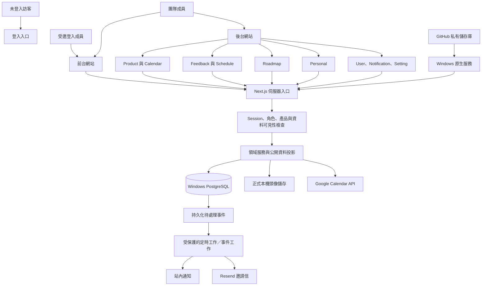
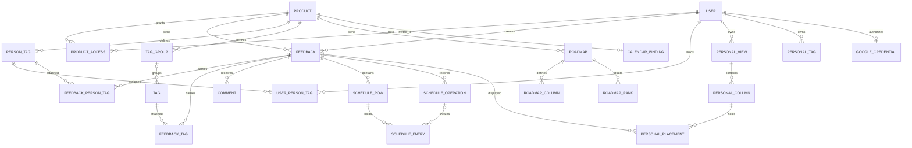

# 系統架構與資料模型

## 架構原則

採模組化單體：同一份 Next.js／TypeScript 程式、兩個網站入口、共用伺服器服務層與 Windows PostgreSQL。約 30 人規模不需要微服務或自建常駐 WebSocket 叢集。

GitHub 保存程式與 CI；Windows 服務執行應用及 PostgreSQL，正式 filesystem 儲存頭像。Tunnel 提供受控外部 HTTPS 入口，資料庫不對外開放；不讓瀏覽器持有管理金鑰。



## 模組邊界

| 模組 | 責任 |
| --- | --- |
| Identity | OIDC、session、邀請接受、角色變更、成員存取。 |
| Products | 產品與初始化、選項管理、產品範圍驗證。 |
| Feedback | 主資料、版本／Tag 一致性、普通留言、投票、公開投影。 |
| Schedule | 指令解析、列、表格項目、操作事件、歷史移除與草稿提交。 |
| Roadmap | 單一維度定義、欄位映射、排序與單維度修改。 |
| Personal | 責任清單查詢、私人欄位、私人位置與個人 Tag。 |
| Notifications | 接收者計算、事件去重、未讀與存取檢查。 |
| Calendar | 個人授權、產品日曆綁定、Google API adapter、ETag 與重試。 |

所有 Feedback 寫入入口共用同一服務層；Roadmap 不直接繞過單選／版本驗證更新資料表。API 路由只做輸入解析、驗證呼叫與回應序列化。

## 建議程式配置（實作時建立）

```text
src/
  app/                 # 前後台路由與 API handlers
  components/          # 共用介面元件與 design tokens
  modules/
    identity/ products/ feedback/ schedule/ roadmap/
    personal/ notifications/ calendar/
  server/              # DB、authorization、outbox、第三方 adapters
  contracts/           # request/response schemas、共享型別
db/migrations/         # 版本化結構與可重複初始化
tests/                 # 單元、DB 整合、API 權限與 E2E
```

這是目標結構，並非已存在的程式或可執行指令。

## 網站與身分隔離

- `admin.<domain>` 與 `feedback.<domain>` 指向同一 Windows Next.js 應用；Host 依明確 allowlist 決定網站與路由，不接受任意 Host 建立 OAuth 回跳網址。
- 兩站以 host-only、Secure、HttpOnly、SameSite cookie 保存 session；不使用涵蓋所有子網域的廣域 cookie。
- 同一 Google 帳號可分別在兩站建立 session；不承諾跨站無跳轉登入。Google 自有登入狀態可縮短再次授權，但不能假設永遠存在。
- Google 登入與 Calendar 授權使用不同流程及 callback；Calendar 只從後台發起。
- cookie 驗證寫入需防 CSRF，OAuth 使用 state、nonce／PKCE 等成熟 library 支援；後端驗證 issuer、audience、subject 與 Email verified。
- 登入頁／callback 可匿名進入必要流程；後台資料查詢需團隊資格，前台資料查詢需團隊或受邀產品資格。
- 每個私人查詢都把 owner_id 從 session 取得，不能信任請求傳入的 owner。

## 核心關係圖



## 資料字典

所有本地 ID 使用 UUID；時間戳為 `timestamptz`，API 使用 ISO 8601。以下是邏輯結構，正式 SQL migration 需依相依順序建立外鍵與檢查。

### 身分與產品

| 資料表 | 重要欄位 | 限制 |
| --- | --- | --- |
| users | id、google_sub、verified_email、display_name、avatar_path、role、membership_state、revision | google_sub 唯一；role=team/tester；removed 帳號不取得成員權限。 |
| sessions | id_hash、user_id、expires_at、revoked_at | 不以可猜 session ID 為憑證。 |
| invitations | id、email、role、token_hash、expires_at、accepted_at、revoked_at、created_by、revision | token_hash 唯一；接受時檢查 Email 與有效狀態。 |
| invitation_products | invitation_id、product_id | 邀請測試成員的目標產品集合。 |
| product_access | user_id、product_id、granted_at | 複合唯一；團隊以角色取得所有產品權限。 |
| products | id、name、slug、created_at、revision | slug 唯一且穩定；第一版不刪除。 |
| statuses / categories | id、product_id、name、display_order、is_default | 每產品 name 唯一；預設值不可在無替代下刪除。 |
| person_tags | id、product_id、name | name 於產品內唯一；未安排不建立職掌實體。 |
| user_person_tags | user_id、product_id、person_tag_id | 只能給有效團隊成員；三元關係唯一、產品一致。 |

最後一位團隊成員保護需在交易內取得組織鎖或等效序列化，不能先 count 再獨立降級，否則兩人同時操作可能使團隊歸零。

### Feedback 與標籤

| 資料表 | 重要欄位 | 限制 |
| --- | --- | --- |
| feedback | id、product_id、author_id、title、description、status_id、category_id、priority、visibility、source、created_at、updated_at、revision、deleted_at | 狀態／類別必填且同產品；priority=P0..P3；visibility=internal/public；source=admin/portal。 |
| tag_groups | id、product_id、name、selection_mode、system_key | mode=single/multiple；每產品只有一個 system_key=version，且固定 single。 |
| tags | id、product_id、group_id nullable、name | 無群組可多選；禁止跨產品引用。 |
| feedback_tags | feedback_id、product_id、tag_id、group_id nullable | 每筆 Tag 關係唯一；group_id 必須與 Tag 真實群組相符。 |
| feedback_person_tags | feedback_id、product_id、person_tag_id | 多對多，無關係代表未安排。 |
| comments | id、product_id、feedback_id、stream、kind、body、author_id、reply_to_id nullable、quoted_author_id nullable、created_at、edited_at、deleted_at、revision | stream=general/schedule；kind=normal/command；回覆必須同 Feedback、同 stream。 |
| comment_likes | comment_id、user_id | 唯一；只允許 normal 留言。 |
| feedback_votes | feedback_id、user_id | 唯一，可取消。 |

`version_tag_id` 不另寫入 feedback 表。從版本群組關係查得，API 可回傳唯讀衍生欄位 `version`。若請求透過版本欄位更新，服務層轉為該群組的 Tag 替換。

群組模式在別表，單靠 `UNIQUE(feedback_id, group_id)` 會錯誤禁止複選。正式實作需用 DB constraint trigger／交易鎖驗證單選群組最多一筆；至少鎖定 Feedback，再驗證組合、刪舊加新。群組模式修改也需取得群組鎖並重新驗證，不只依前端限制。

### Schedule

| 資料表 | 重要欄位 | 限制 |
| --- | --- | --- |
| schedules | feedback_id、product_id、revision | 每 Feedback 一份。 |
| schedule_rows | id、feedback_id、product_id、display_row | display_row 從 2 開始，單一 Schedule 內唯一，固定追加且不重排。 |
| schedule_operations | id、feedback_id、actor_id、type、row_id nullable、column_index nullable、comment_id nullable、payload、created_at、hidden_at、hidden_by | 內容不可覆寫；type 含 append、clear、row.add、comment 類與 history.hide。 |
| schedule_entries | id、row_id、column_index、author_id、author_name_snapshot、avatar_ref、body、operation_id、created_at、removed_at、removed_reason | column_index=1..5；append 操作與 entry 一對一；removed_reason=clear/history_hide。 |

操作事件記錄實際影響的 entry IDs；clear 不以「目前畫面看到的內容」作為範圍。所有寫入依 Schedule revision 序列化，避免清空與新增競態造成誤刪。

`hidden_at` 是使用者可見歷史的移除標記，不是刪除伺服器追蹤；`removed_at` 的 entry 永不因刪除 clear 紀錄而復活。

### Roadmap 與 Personal

| 資料表 | 重要欄位 | 限制 |
| --- | --- | --- |
| roadmaps | id、product_id、name、description、dimension、tag_group_id nullable、sort_mode、is_default、portal_published、revision | dimension=status/category/tag_group；tag_group 必須 single；建立後 dimension 固定；sort=create_time/freedom；revision 只版本化結構與設定，卡片移動不遞增（首次切 freedom 除外）。 |
| roadmap_columns | id、roadmap_id、label、order、status_id nullable、category_id nullable、tag_id nullable、is_unclassified | 選項對應型別符合 dimension；同選項唯一；每 Tag 看板恰一未歸類欄。 |
| roadmap_ranks | roadmap_id、column_id、feedback_id、rank、placement_revision | 每 roadmap＋feedback 最多一筆有效排序；實際欄位仍由 Feedback 資料推導，不以 rank 決定欄位；placement_revision 是單卡排序版本，供移動做樂觀檢查（重編號不遞增）。 |
| personal_views | id、owner_id、product_id、subject_user_id、sort_mode、revision | owner＋product＋subject 唯一；subject 只能是有效團隊成員。 |
| personal_columns | id、view_id、name、order、is_default | 每 view 一個固定預設欄，至少一欄。 |
| personal_placements | view_id、feedback_id、column_id、rank | view＋feedback 唯一；欄位須屬同 view；卡片須仍屬 subject 責任清單。 |
| personal_tags | id、owner_id、product_id、name、revision | owner＋product＋name 唯一。 |
| personal_feedback_metadata | owner_id、product_id、feedback_id、revision | owner＋feedback 唯一，作為整組私人 Tag 更新的併發版本。 |
| personal_feedback_tags | owner_id、product_id、feedback_id、personal_tag_id | 每次讀寫校驗本人與同產品；與被查看負責人無關。 |

Roadmap 沒有「人工卡片歸屬」表；rank 只是排序資料。跨欄變更後其他同維度看板依新值重新分欄，舊 rank 必須清理或視為失效。Personal 不共用此機制。

### 通知、外部整合與工作

| 資料表 | 重要欄位 | 限制 |
| --- | --- | --- |
| domain_events | id、product_id、actor_id、type、payload、created_at | 與主要變更同交易提交。 |
| outbox_jobs | id、event_id、job_type、state、attempts、next_attempt_at、lease_until | 可重試、租約領取；工作完成才標記成功。 |
| notifications | id、event_id、recipient_id、product_id、feedback_id nullable、reason_codes、read_at、created_at | event＋recipient 唯一；reason_codes 合併，讀取時重驗權限。 |
| google_credentials | user_id、provider_sub、encrypted_refresh_token、granted_scopes、expires_at、revoked_at | 僅後端可讀；加密金鑰不與 ciphertext 同存。 |
| calendar_bindings | product_id、calendar_id、calendar_timezone、bound_by、revision | 每產品一份；工程預設同 Google calendar 不跨產品重複綁定，避免跨產品洩漏。 |
| calendar_event_links | product_id、calendar_id、event_id、feedback_id、revision | calendar＋event 唯一，第一版每活動最多關聯一筆；只作關聯，不複製活動；series／instance ID 不混用。 |
| calendar_mutations | user_id、product_id、request_key、operation、google_event_id、body_hash、state、result_ref | 相同 key 不可對不同 payload；處理外部成功、本地回應失敗。 |
| idempotency_records | actor_id、scope、key、body_hash、status、response_ref、expires_at | 保護 Feedback、指令、拖曳等重試不重複執行。 |

本地 DB 與 Google／Resend 無法使用同一個 ACID 交易。用持久化工作或 mutation 狀態處理重試；不能把外部請求包在 DB 交易裡就宣稱跨服務原子性。

## 索引與查詢

- Feedback：`(product_id, deleted_at, created_at DESC, id DESC)`、`(product_id, status_id)`、`(product_id, category_id)`、公開查詢 visibility 部分索引。
- Tag／Person tag 關係建立反向索引，以 tag_id／person_tag_id 找 Feedback。
- Personal 責任清單用 EXISTS／DISTINCT，避免一人符合多個職掌產生重複卡片。
- Notification：`(recipient_id, product_id, read_at, created_at DESC)`。
- 留言：`(feedback_id, stream, created_at, id)`；Schedule entry：`(row_id, column_index, created_at, id)`。
- 文字搜尋先用參數化 Unicode ILIKE；資料成長時評估 pg_trgm，須用繁中樣本驗證，不以新增搜尋服務作第一版前置條件。
- 大列表 cursor 分頁，預設 50、上限 100；看板各欄可分頁，唯一欄位與計數在伺服器完整資料集上計算，不能只依已載入頁數。

## 資料保護與一致性

- 產品外鍵使用複合關係或等效 DB 檢查，拒絕將 A 產品 Tag 掛到 B 產品 Feedback。
- 服務層實施授權；資料庫避免以公開 anon 權限直接開放業務表。若後續採 client SDK 直連，必須另設完整 RLS 與測試，不能只加上 client key 即開放。
- 前台回應採 allowlist DTO，不先回傳整個內部物件再由前端隱藏。
- 私人 cache key 至少包含 user＋product＋subject；公開 cache 不混入身分資料。內部回應使用 private/no-store。
- 發布／取消發布、成員移除、角色修改皆需失效快取與後續授權檢查。
- 軟刪除內容不再出現在一般查詢；歷史作者採保留識別，使用者改名不改變操作責任。
- 所有重排、群組替換、Schedule 指令使用交易與 revision／鎖；非同步工作用事件 ID 去重。

## 初始化

初始化程序需可重複執行，以系統鍵與唯一限制避免新增第二份產品／預設值：

1. 建立指定首位團隊資格。
2. 建立「產品1」。
3. 建立狀態：新貼文、進行中、待討論、已完成、延後。
4. 建立類別「需求討論」、版本 single 群組；不自動建立 UIUX 等職掌，僅作使用者可新增範例。
5. 建立預設狀態 Roadmap 及五欄映射。
6. 不產生假 Feedback、通知、日曆或假使用者供正式環境展示。
