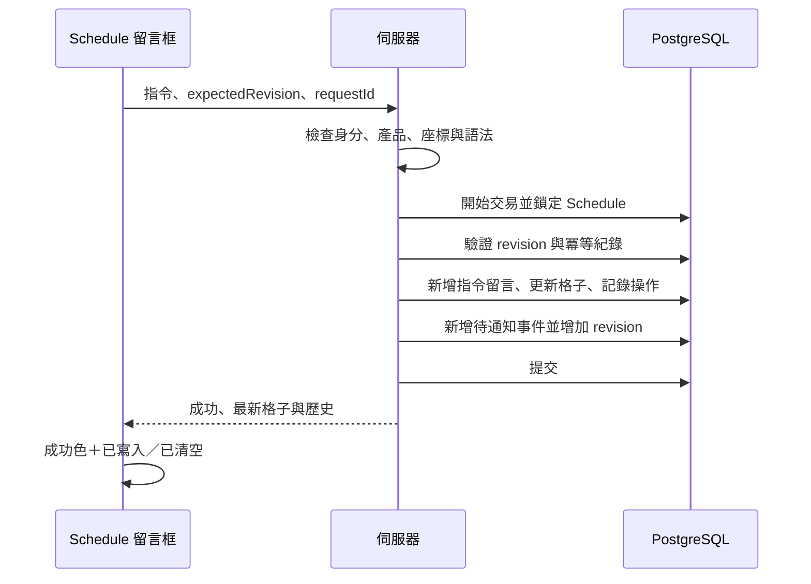

# 核心互動與一致性規則

## Schedule【新功能】

### 表格與座標

每筆 Feedback 一份 Schedule；建立 Modal 與查看／編輯 Modal 均提供 Schedule Tab。

| 顯示列 | 第 1 欄 | 第 2 欄 | 第 3 欄 | 第 4 欄 | 第 5 欄 |
| --- | --- | --- | --- | --- | --- |
| 1（表頭） | PO | UIUX | 前端 | 後端 | QA |
| 2（初始內容列） | 空白 | 空白 | 空白 | 空白 | 空白 |

- 表頭無法作為指令目標；點選表頭不改變輸入框。
- 表格下提供「新增一排」，只能追加第 3、4…列，不刪列、不重排、不改欄名。
- 表格下方依序為「留言區」「操作歷史紀錄」Tab。
- 表格列使用穩定 ID，座標是顯示位置。禁止依 DOM 索引直接定位資料。
- 每格可包含多筆項目，依建立時間舊到新排列；每筆顯示姓名、頭像、文字與當地日期。

### 指令文法

只在 Schedule 留言串解析指令。普通 Feedback 留言中的 `/2-3` 只是文字。

```text
/列-欄 內容
/列-欄 delete

/2-3 完成搜尋欄位的鍵盤操作
/2-3 delete
```

工程預設文法：先去除首尾空白，以 `/` 開頭者必須符合指令語法，否則回傳錯誤，不降級為普通留言。列欄只接受十進位正整數、欄為 1–5、列必須存在且 ≥2；座標後至少一個空白再接非空內容。第一版一則留言只執行一條指令，其餘換行是同一筆內容。

- payload 去除首尾空白後**完全等於小寫 `delete`**才清空；`delete all`、`Delete` 視為文字寫入。
- 缺少內容、目標不存在、表頭座標或權限不足：不新增留言、項目、歷史或通知。
- 清空本來已空的格子仍是成功操作，記錄影響 0 筆。
- 若真的要填入單字 delete，可使用一般說明文字（例如「操作：delete」）；本版不設跳脫指令。

### 點選格子與草稿

點選可編輯格子，顯示選取框與 `/列-欄` 提示，輸入框帶入座標並聚焦；已有有效指令時只替換座標、保留 payload。輸入框已有一般留言時不得無聲覆蓋，可讓使用者確認轉為指令或先送出／保留原文。

尚未建立 Feedback 時，所有 Schedule 列、指令、普通留言與操作歷史都先保存於 Modal 草稿：

- 指令成功解析與套用後顯示成功色及「已套用至草稿」。
- Feedback 送出時，主資料、列、留言、項目、操作事件同一 DB 交易提交。
- actor 取自 session；正式時間以伺服器接受順序為準，不相信客戶端自填作者與時間。
- 任何一步失敗，全部不提交，原草稿保留。
- 取消草稿不寄通知、不殘留孤立 Schedule。
- 新增多筆成功後，下一筆恢復一列空白內容列，所有 Schedule 草稿清空。

### 正式操作的原子流程



若交易失敗，四者都不改變。若客戶端未收到回應，以同 requestId 重試取得相同結果，不重複新增。指令被保存為留言時，保留原文字與對應 operation ID。

成功顏色不能是唯一訊號：附上勾選圖示、文字、對輔助技術的 live announcement。正式提交前不可顯示「已儲存」。

### 操作歷史與移除

操作記錄顯示：頭像、操作者、表格座標／Schedule 名稱、操作摘要、相對時間、移除按鈕；hover／展開可看完整時間。

記錄所有造成 Schedule 持久狀態變化的操作：新增列、寫入／清空格子、普通留言新增／編輯／移除、按讚／取消、歷史移除。切 Tab、聚焦、捲動、瀏覽等純介面行為不記錄。Feedback 狀態、類別與 Tag 變更不列入 Schedule 歷史。

移除前用確認 Modal 呈現具體後果：

| 被移除的歷史類型 | 格子與其他資料的結果 |
| --- | --- |
| 寫入 | 只移除該 operation 建立的 entry；同格其他項目保留。若該 entry 已清空則不再影響資料。 |
| 清空 | 隱藏該歷史，不恢復任何已清空項目。 |
| 新增列 | 隱藏該歷史，列及內容保留，座標不移動。 |
| 留言／按讚類 | 隱藏該歷史，不回復或刪除原留言／按讚狀態。 |
| 移除歷史事件 | 隱藏該事件，不恢復先前移除結果。 |

每次移除本身也產生一筆 history.hide 事件，記錄目標操作；不遞迴執行目標操作。使用者可見記錄採軟移除，底層稽核仍保留。指令留言持續存在，標註「操作紀錄已移除」；若寫入已被清空，也可標註「內容已清空」，不可誤顯示仍有效。

### 普通留言、回覆與按讚

- 非 `/` 開頭者為普通留言，可按讚／收回；同一使用者一則留言最多一個讚。
- 指令留言不提供按讚、事後編輯或直接刪除，避免重新執行及與表格脫節。
- 回覆建立新留言，保存 reply_to_id 與被引用者 ID，畫面帶入 `@名稱`；不是只拼接姓名字串。
- 一般留言被刪除後，回覆保留「原留言已移除」而非洩漏原文。
- 普通留言可引用指令留言，但回覆本身是普通留言，不因引用內容而重新執行指令。

## Roadmap：單維度、唯一分欄

### 定義與預設

每張看板只有一個 immutable dimension：`status`、`category` 或一個 `single` Tag 群組。一般未分組 Tag、複選群組、Person tag、優先級均不可作為第一版分欄維度。

所有選項都有一欄；Tag 群組另有固定未歸類欄。每個選項恰一欄，至少一欄；不提供 AND／OR 或每欄自由條件。

預設看板：

| 順序 | 欄名 | 對應狀態 |
| --- | --- | --- |
| 1 | 需求池 | 新貼文 |
| 2 | 進行中 | 進行中 |
| 3 | 待討論 | 待討論 |
| 4 | 已完成 | 已完成 |
| 5 | 延後 | 延後 |

可新增多張看板、修改名稱描述、調整 Tab／欄位順序與欄位顯示名稱；Tab 列橫向滑動，右側固定「＋」。第一版不提供直接刪除仍代表有效選項的欄位。要取消選項需走 Setting 的引用處理流程。

新增分類選項時，同交易為所有相關看板補欄；Tag 改名只變名稱不變 ID。單一非預設看板可刪除（確認後刪看板與排序），不刪 Feedback；預設看板保留。

### 唯一欄位函式

```text
column(feedback, roadmap):
  status   -> 唯一對應 feedback.status_id 的欄位
  category -> 唯一對應 feedback.category_id 的欄位
  tag_group -> 該群組唯一選中 tag 的欄位；沒有則未歸類
```

對產品內每筆未刪除 Feedback，後台每張 Roadmap 恰好得到一欄。前台先限制公開卡片，再套相同分欄函式；內部卡片不計入前台欄位數量。

如果資料損壞而有多個單選 Tag 或缺失欄位，回傳明確資料一致性錯誤並停止拖曳，不以「挑第一筆」掩蓋缺陷。

### 拖曳

| 維度 | 拖入效果 | 保留項目 |
| --- | --- | --- |
| 狀態 | 設為目標 status_id。 | 類別、全部 Tag、Person tag、優先級。 |
| 類別 | 設為目標 category_id。 | 狀態、全部 Tag、Person tag、優先級。 |
| Tag 群組 | 清除該群組原 Tag，再設定目標 Tag；未歸類則只清除。 | 其他群組、未分組 Tag、狀態、類別、Person tag、優先級。 |

版本看板更新的是版本群組唯一 Tag；Feedback 的版本欄位為同一資料的投影，不能短暫分歧。

拖曳交易包含卡片排序 revision、跨欄時的 Feedback revision、單維度變更、排序更新與事件。任一失敗全部不變；客戶端顯示 pending，成功後同步相關列表／看板。同欄拖曳只改順序，不改 Feedback revision 或業務欄位。

併發只限縮在真正衝突的範圍：看板 revision 只代表結構（欄位、排序模式、設定），拖曳不檢查它；同一張卡被他人先移動或修改時回 409 並重新載入，不自動重試；不同人移動不同卡片互不阻擋，只有指定的相鄰卡已離開該欄或先後顛倒時才回 409，請使用者重新放置。詳見 [API 契約](04-api-contracts.md) 的 Roadmap 移動。

### 排序

- 每張 Roadmap 共用一個排序模式：`create_time`（預設）或 `freedom`。
- create_time 為 created_at DESC、id DESC，所有欄位相同規則。
- 同欄手動重排、跨欄指定落點都切換該張看板至 freedom；初次切換先以完整的原建立時間順序初始化所有欄位 rank，再套移動。
- 拖曳 API 用前後相鄰卡片 ID 描述落點，伺服器計算 rank；不能使用只有前端分頁內意義的數字 index。
- 切回 create_time 不刪除已存 freedom 排序；再次切 freedom 可沿用。
- 經其他頁面新增或改欄的卡片，在 freedom 模式放到目標欄頂端；未受影響卡片順序保留。
- 在其他看板因相同維度改變而移欄時，不改其他看板排序模式；該看板若 freedom，依上項處理。
- UI 提供鍵盤與選單「移至欄位／調整順序」，效果與拖曳一致。

## Personal【新功能】：私人自由整理

### 責任清單

```text
responsible(feedback, subjectUser) =
  feedback.product == currentProduct
  AND subjectUser 是有效團隊成員
  AND intersection(feedback.personTags, subjectUser.personTags) 非空
```

一人有多個職掌、同一筆有多個職掌時，只顯示一張卡片。沒有職掌的成員顯示空狀態，不把「未安排」解釋為該成員負責。

表頭保留負責人 Dropdown，預設本人；顯示所選成員及其 Person tag。更換 subject 只改查詢責任清單，owner 永遠是目前登入者。

### 欄位與卡片

- 初次開啟建立預設欄「負責的 Feedback」；可新增任意命名的私人欄位，不設定篩選。
- `owner＋product＋subject` 的欄位、卡片位置與排序分開保存；另一團隊成員看相同 subject 時取得自己的版本。
- 新分派或首次出現的卡片進預設欄。切換模式或重新整理不重設既有位置。
- 拖曳只更新 personal_placements；即使跨欄也不修改狀態、類別、任何 Tag 或個人 Tag。
- 不再負責、Feedback 被軟刪除或 subject 離開團隊時，卡片離開檢視並清理 placement；重新取得責任時重新進預設欄。
- 預設欄不可刪除；刪除自訂欄前確認，所有卡片移回預設欄，不刪 Feedback。
- 個人 Tag 歸 owner＋product 所有；從 Personal 開啟 Feedback 時顯示第三排，切換 subject 不會切換到對方私人 Tag。

### 自動儲存與排序

- 預設 create_time，欄內最新在上。手動同欄／跨欄拖曳自動切換該 view 至 freedom。
- 與 Roadmap 相同，第一次切自由排序先初始化順序；回切時間排序不刪除私人欄位歸屬與已存 rank。
- 新增欄、名稱確認、刪欄、拖曳、排序模式切換均自動送出，不設整頁儲存按鈕。
- 顯示「儲存中／已儲存／儲存失敗」。失敗回復最後已確認位置，並提供重試；名稱編輯草稿保留。
- 每個 view mutation 帶 expectedRevision；同一人多個分頁衝突時重新載入，不用最後到達請求覆蓋全部看板。
- 有未完成儲存時不要悄悄丟棄操作；切產品／負責人前等待回應或提示尚未完成，不能先寫到新 view。

## 通知事件演算法

指派通知接收者 = 更新後的負責成員集合 − 更新前的負責成員集合 − 操作者，且須為仍有效的團隊成員。移除職掌本身不發指派通知。

普通／Schedule 留言通知目標為建立者，但需通過內容存取檢查，並排除操作者。若同一交易同時產生指派與留言原因，以交易 domain_event ID＋recipient 去重並合併原因。

Person tag 持有人事後變更只更新 Personal 清單，不追溯指派通知；通知 worker 重試不得多發。Schedule 內容不透過通知正文或預覽洩漏給測試作者。
