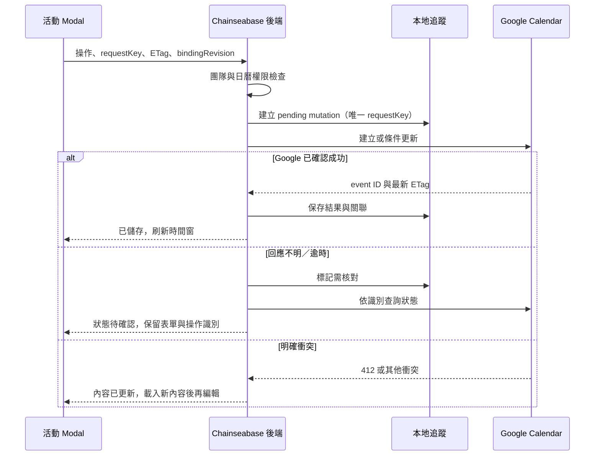

# Google Calendar 與雲端部署

## Calendar 範圍

每產品綁定一個 Google 共用日曆。每位團隊成員使用自己的 Google 授權，由公司在 Google 日曆提供相應分享權限。Chainseabase 可新增、查看、編輯及刪除活動，不以單一管理員 token 代理全體操作。

Google 是活動正式來源；本地只保存綁定、Feedback 關聯、短期快取與寫入追蹤，不建立另一份獨立日曆與 Google 互相覆寫。

第一版包含月／週／活動清單、單次活動、基本重複活動、本次／整個系列修改與刪除、全天活動、時區、地點、說明、Feedback 關聯及拖曳改期。

不包含本次及之後、參與者管理／邀請、Google Meet、獨立提醒設定 UI、Schedule 自動轉活動、背景雙向全量同步。Google 提醒沿用既有日曆／活動設定，更新時不可清掉。

## 授權與權限

1. 平台登入只請求身分必要 scopes，不因登入就取得 Calendar 權限。
2. 後台「連結 Google 日曆」發起增量授權，規劃 scopes：`https://www.googleapis.com/auth/calendar.events` 與 `https://www.googleapis.com/auth/calendar.calendarlist.readonly`。實作前依當時官方文件核對支援與最小權限需求。
3. Calendar 帳號的 Google subject 必須與目前登入帳號相同；若選錯帳號，拒絕綁定並提示改用本人帳號。
4. offline access 的 refresh token 加密保存，僅後端使用；Google 不一定每次重發 refresh token，更新時不得以空值覆蓋既有有效 token。
5. 日曆選單只列本人可存取清單，建立綁定要求 writer／owner 權限；不在平台改 Google ACL。
6. 其他團隊成員仍需各自授權與被分享該日曆。reader 可唯讀，無權者看到明確提示；團隊最大產品權限不能提升 Google 權限。
7. 不將日曆設為公開來解決存取問題。前台／測試成員無 Calendar API 入口。
8. 個人解除 Calendar 連線不刪公司日曆；產品解除綁定也不刪活動。解除後所有新請求停止使用該關係。

OAuth client／consent screen 可能有組織限制、測試使用者、敏感 scope 驗證或測試模式 token 有效期要求；實作時確認 Google Workspace 組織類型與正式發布條件。不能以開發者短期測試授權宣稱可長期正式使用。

### 憑證生命週期

- refresh token 密文與加密金鑰分開儲存；金鑰在雲端 secret 設定，支援 key version 與輪替。
- access token 只在後端短期保存；不傳到瀏覽器、不寫 URL／分析事件／日誌。
- token 到期時由後端刷新；invalid_grant／撤銷時標記需要重新授權，停止不斷重試。
- 移除／降級團隊成員時撤銷平台使用資格並清除 Calendar 憑證，不改其 Google 帳號本身。
- 日曆快取依 user＋calendar＋日期窗隔離；不能用 A 的憑證取得資料後直接供無 Google 權限的 B 讀取。

## 活動契約

| 欄位 | 規則 |
| --- | --- |
| summary | 必填，工程預設最多 200 字元。 |
| description | 文字說明，工程預設最多 20,000 字元；展示須防 HTML 注入。 |
| location | 可空，最多 500 字元。 |
| timed start/end | RFC3339 offset＋IANA timezone，end 必須晚於 start。 |
| all-day start/end | YYYY-MM-DD，結束日期為 exclusive；UI 顯示含最後一天，adapter 做轉換。 |
| recurrence | 基本每日／每週／每月、間隔、結束日期或次數；不能同時輸入互斥的結束條件。 |
| etag | Google 原值，用於條件更新。 |
| event ID | series 與 occurrence 使用各自 ID；不可只以畫面日期當識別。 |
| feedback link | 僅同產品 Feedback；只建立關聯，不改狀態、Tag 或 Schedule。 |

例如全天 2026-10-27 一天，Google start.date=2026-10-27、end.date=2026-10-28。不要先轉 UTC 午夜再切日期。

讀取完整 Google 活動後以 allowlist PATCH 更新；保留未支援欄位與既有 reminders，避免完整 PUT 導致內容遺失。UI 清楚標示可編輯性。

第一版不新增 attendees／conferenceData。對已在 Google 建立且含邀請對象或會議資訊的活動，工程預設唯讀並連結 Google，避免在尚未支援通知／主辦者語意時意外影響參與者。birthday、focusTime、outOfOffice、workingLocation 等非一般事件也先唯讀。

### 重複活動

- 查詢時間窗展開 occurrences，顯示 recurringEventId 與 originalStartTime 對應的 occurrence identity。
- 「本次」：對該 instance ID 更新／刪除，不能修改 series master。
- 「整個系列」：重新取得 master 及其 ETag，再修改 master；不能拿 instance ETag 當 master ETag。
- 編輯整系列時，表單讀 master 的起始基準，不能把點到的第三次活動日期寫回第一天，造成系列縮短或重排。
- 既有取消／改期例外必須保留，除非使用者操作本身明確改變系列排程；確認視窗說明系列變更可能影響例外，並在 sandbox 日曆驗收實際 Google 行為。
- 外部建立的複雜 RRULE／RDATE／EXDATE 若無法無損編輯，保留規則只允許安全欄位更新，或整筆唯讀並連結 Google；不得偷偷降級為單次活動。
- 不顯示「本次及之後」選項；它需要拆分系列，另列後續範圍。

## 外部一致性與重試

Google API 與 PostgreSQL 不存在共同交易。採明確 mutation 狀態而不是宣稱一起 rollback。

- 建立活動使用符合 Google ID 字元限制的穩定 client-generated event ID，例如 requestKey 雜湊後的 lowercase hex；同 key 重試不能另建一筆。
- 若建立回 409，取得該 ID 並驗證屬本次操作，而非直接當成功。
- 更新／刪除帶 If-Match ETag。Google 412 回平台 409；保留使用者輸入，不自動以新 ETag 強制覆寫。
- 更新回應逾時時，重新讀取目前活動與 mutation 記錄；無法確定是否本次寫入時顯示待核對，不盲目重放。刪除後 404 可在已驗證目標與操作記錄的情況下視為完成。
- Google 成功但本地關聯寫入失敗時，活動不應重建；重試只完成追蹤／關聯補寫。
- Google 429／5xx 使用有上限的指數退避與 jitter。授權錯誤、驗證錯誤、ETag 衝突不屬無條件重試。
- 日曆綁定修改與 mutation 不能錯配；請求綁定 revision 過期時先拒絕。已送出的舊綁定操作在結果中清楚標示原日曆，不轉寫新日曆。

## 讀取與更新頻率

- 初次載入與月份／週切換讀取對應時間窗，處理 Google 分頁，不能漏掉 nextPageToken。
- 前景每 60 秒更新目前窗、視窗重新聚焦更新、寫入成功立即更新；背景暫停，提供手動刷新。
- 顯示上次成功更新時間。30 人的實際配額仍需實測與監控，不承諾固定延遲即時同步。
- 第一版不用推播 watch／長期 syncToken；若日後加入，另處理 channel 到期續租、webhook 驗證與 sync token 失效。

## 雲端部署拓樸

| 服務 | 用途 | 邊界 |
| --- | --- | --- |
| GitHub private repo | 原始碼、PR、CI 與部署來源。 | 不保存 secrets，不用 Pages 作完整應用後端。 |
| Vercel | Next.js 前後台、API、Google callbacks。 | 兩個 host 同一應用，函式無持久程序狀態。 |
| Supabase PostgreSQL | 產品、Feedback、Personal、授權密文與工作資料。 | server-only 連線，使用適合 serverless 的 pooler。 |
| Supabase Storage | 頭像檔案。 | 限定本人可寫路徑，讀取公開頭像不暴露 Email。 |
| Resend | Email 邀請。 | 驗證寄件網域；只寄使用者明確操作的邀請。 |
| Google Cloud／Calendar | 登入、各使用者授權與活動來源。 | client、scope、日曆 ACL、配額分別驗證。 |

長期工作不能依賴 Vercel handler 回應後仍持續的記憶體 timer。通知與 Email 以 DB outbox 保存，由受保護的 scheduled function 或受控工作服務領取；工作服務可用 Vercel 排程，但採用前核對方案的執行頻率、函式時間與商業條款。

## 環境與秘密變數

| 名稱 | 類型 | 用途 |
| --- | --- | --- |
| DATABASE_URL | secret | runtime pooler 連線。 |
| DIRECT_DATABASE_URL | secret | migration 用直接連線，只授予 migration 工作。 |
| GOOGLE_CLIENT_ID | configuration | OAuth client 識別。 |
| GOOGLE_CLIENT_SECRET | secret | Google OAuth server secret。 |
| AUTH_SESSION_SECRET | secret | session／簽章。 |
| TOKEN_ENCRYPTION_KEY | secret | Calendar refresh token 加解密。 |
| ADMIN_ORIGIN / PORTAL_ORIGIN | configuration | 正式允許網域與 callback origin。 |
| BOOTSTRAP_TEAM_EMAIL | configuration，個資 | 首位團隊成員，初始化完成後限制重跑用途。 |
| RESEND_API_KEY | secret | 寄邀請信。 |
| RESEND_FROM_EMAIL | configuration | 已驗證網域的寄件地址。 |
| SUPABASE_URL | configuration | Storage 服務。 |
| SUPABASE_SERVICE_ROLE_KEY | secret | 後端 Storage 操作；不可進入 client bundle。 |
| JOB_RUNNER_SECRET | secret | 定時工作入口驗證。 |

這些是需求名稱，不是已建立或注入的環境變數。使用 Vercel／CI 的安全設定，不把值寫入文件、PR 或前端 `NEXT_PUBLIC_*`。需要本地測試時使用 ignored 的環境檔，另提供無秘密的範例。

## 部署前置條件

1. 公司提供或建立 GitHub、Vercel、Supabase、Resend、Google Cloud 專案的適當管理存取。
2. 確認正式前後台網域、DNS、HTTPS、資料庫區域與資料備份方案。
3. 驗證寄件網域與寄信能力，設定部署指定的首位團隊 Email。
4. Google OAuth consent screen 完成適用組織／發布／驗證設定，註冊明確的前後台登入與後台 Calendar callback URI。
5. 公司建立產品共用日曆並分享給各使用者；每人授權後驗證 reader／writer 行為。
6. 實作時確認付費方案符合商業用途、備份與排程需求。不得承諾全免費。

## CI 與發布流程

1. PR 執行型別／靜態檢查、領域單元測試、PostgreSQL 整合測試、權限與代表性 E2E。
2. Preview 使用隔離 DB、測試 Google OAuth client／日曆、測試寄信目的地；不讀寫正式資料。OAuth 用穩定 staging 網域，不能把任意 preview URL 當可信 callback。
3. Migration 先在 staging 執行與驗證，正式採可向後相容的 expand／contract；對高影響資料變更先建立可復原備份。
4. 部署前端／API，驗證健康與代表性功能，確認 worker 能處理 outbox。
5. 使用專用測試帳號驗證正式 OAuth callback 與日曆最小讀寫；真實邀請／日曆寫入僅在已授權範圍執行。
6. 發布失敗時回退相容應用版本；資料庫不可盲目 down migration，依備份與遷移計畫處理。

實際指令與已驗證範圍見 [README](../README.md) 與 [operations.md](../operations.md)；雲端部署尚未執行。

## 監控與驗收前準備

- 記錄 request ID、錯誤類型、延遲、outbox 積壓與 Google／Resend 結果碼；敏感正文、邀請 token、憑證不得進 log。
- 每日備份策略與復原演練需配合選定 Supabase 方案落實，不能只勾選備份而未驗證還原。
- 定期檢查邀請工作失敗、Calendar 重新授權比例、通知去重、跨產品權限拒絕。
- 輪替秘密後驗證 session／Calendar 憑證解密相容性。

## 官方參考入口

- [GitHub Pages 能力](https://docs.github.com/en/pages/getting-started-with-github-pages/what-is-github-pages)
- [Calendar OAuth scopes](https://developers.google.com/workspace/calendar/api/auth)
- [Calendar 重複活動](https://developers.google.com/workspace/calendar/api/guides/recurringevents)
- [Calendar 同步](https://developers.google.com/workspace/calendar/api/guides/sync)
- [Google Web Server OAuth](https://developers.google.com/identity/protocols/oauth2/web-server)
- [Vercel 文件](https://vercel.com/docs)
- [Supabase 文件](https://supabase.com/docs)
- [Resend 文件](https://resend.com/docs)

以上為實作時核對入口；本次未完成對當前雲端帳號、方案、Google 審核與 API 行為的實機驗證。
